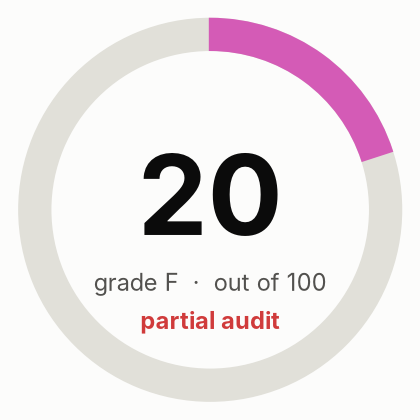
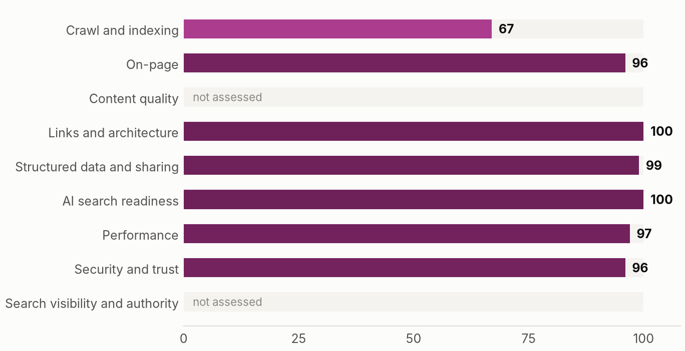
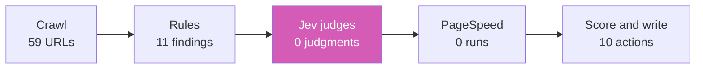
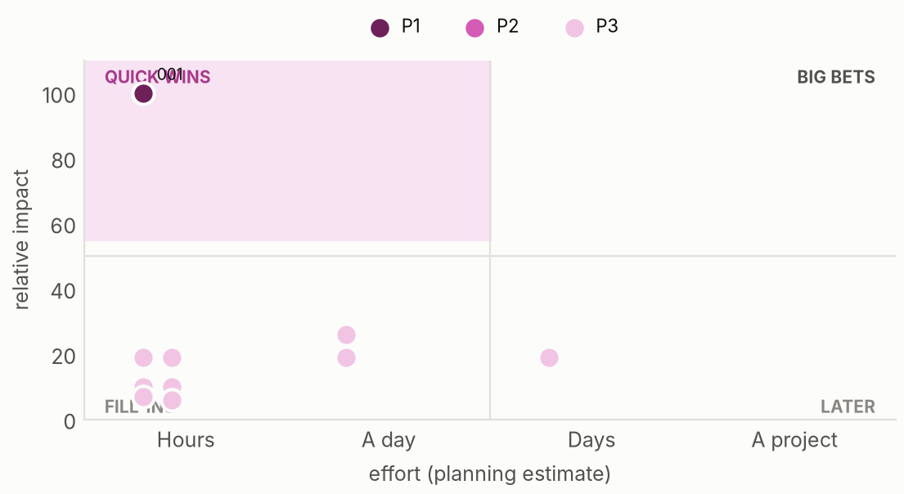
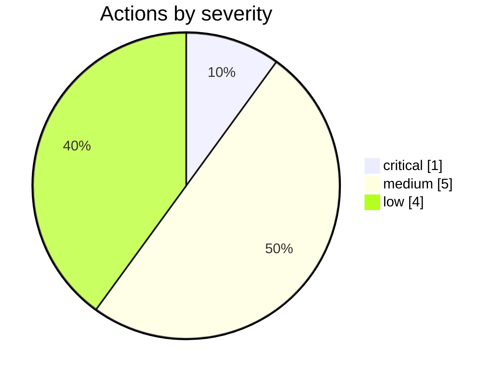
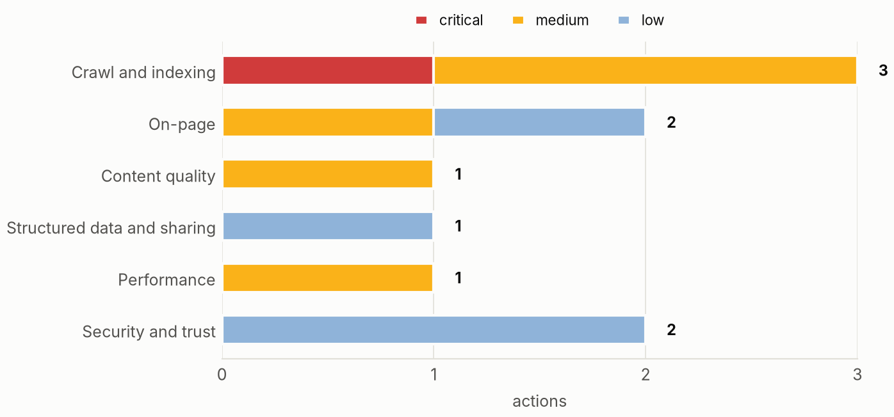
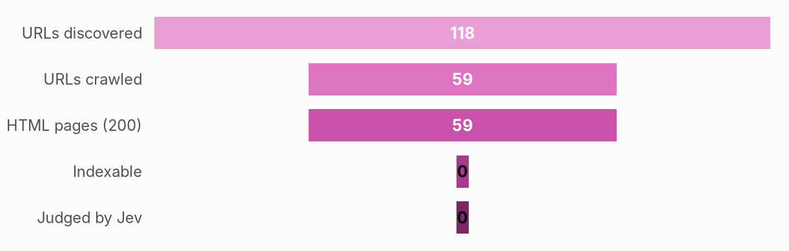
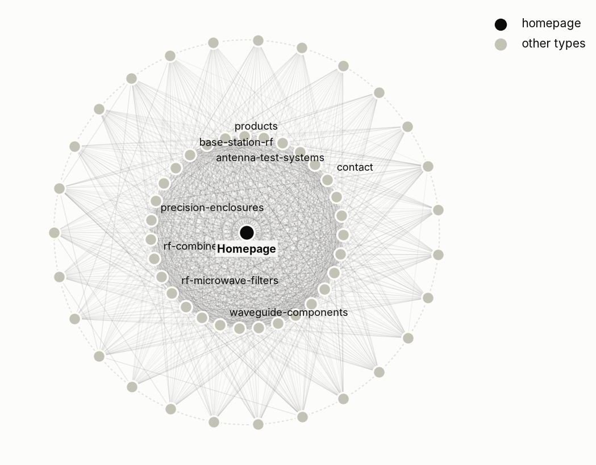

# Jev SEO audit: rf-sonne.com

Audited 2026-10-29T15:02:50+00:00 · 59 URLs crawled · 59 HTML pages · 0 Jev judgments · Jev cost $0.0000

**Overall score: 20/100 (grade F)**. Capped at 20: the homepage or whole site is blocked from search

> **Partial audit:** Jev judgments unavailable, so content quality was not assessed; PageSpeed Insights unavailable, so performance used crawl timings only. The overall score covers only the areas that were assessed.

| Area | Score | Weight | How it is scored |
|---|---:|---:|---|
| Crawl and indexing | 67 | 20 | Rules only |
| On-page | 96 | 15 | Rules only |
| Content quality | n/a | 20 | Not assessed: Jev judgments unavailable |
| Links and architecture | 100 | 10 | Rules only |
| Structured data and sharing | 99 | 8 | Rules only |
| AI search readiness | 100 | 12 | Rules only: Jev judgments unavailable; editorial heuristics, since Google states no special optimization is required for AI features |
| Performance | 97 | 10 | Crawl observations only: PageSpeed Insights unavailable |
| Security and trust | 96 | 5 | Rules only |
| Search visibility and authority | n/a | 15 | Not assessed: run with --full (DataForSEO) |

**Contents:** [Executive summary](#executive-summary) · [How this audit was made](#how-this-audit-was-made) · [Priority actions](#priority-actions) · [What the crawl found](#what-the-crawl-found) · [Findings by area](#findings-by-area) · [Robots access](#robots-access) · [Page inventory](#page-inventory) · [Method and limits](#method-and-limits)

## Executive summary

rf-sonne.com scores 20 out of 100, grade F, and that number is a cap rather than a verdict on the work. All 59 crawled pages carry a noindex directive, so search engines are told to keep the whole site out of results. That is deliberate for a site that is still pre-launch, and it is the one setting that decides whether any other improvement pays off. Underneath the cap the measured areas are strong: on-page 96, links and architecture 100, structured data and sharing 99, AI search readiness 100, performance 97, security and trust 96, crawl and indexing 67.

Read this as a partial audit. Jev semantic judgments were unavailable, so content quality was not scored by machine; three reviewers read the saved pages by hand instead, and their judgments are labelled as such below. PageSpeed Insights returned a rate-limit error for both mobile and desktop, so performance came from crawl timings only. DataForSEO was not run, so there are no rankings, keyword or backlink numbers anywhere in this report. Two things matter most for the business. JEV-001 is the launch switch: until noindex is removed the site cannot appear in search at all. JEV-007 and JEV-008 are the only measured defects that are not consequences of that switch, and both live in the server response rather than in the content.

Four actions in the table describe one page six times over. The crawler reached /request-a-quote with query parameters such as ?topic=pim-verification and ?product=tma and counted each parameter as a separate URL. Those parameters are intentional: internal links on the base-station RF page use them to prefill the quote form. The canonical on every variant points back to /request-a-quote, which is the correct consolidation behaviour, so JEV-003, JEV-004, JEV-005 and JEV-010 are rule artefacts rather than defects. They stay in the action table for completeness and are called out here so nobody spends a week rewriting one page.

**What is working**

- The crawl and the on-page basics are both clean: every page returned HTTP 200 with no broken internal links, no redirect chains, no soft 404s and no mixed content, and every page carries one h1, a title, a meta description, a language attribute, a viewport, no skipped heading levels, and images with alt text plus explicit dimensions.
- Crawler access is wide open where it matters. robots.txt allows Googlebot and Bingbot and all 10 AI crawlers checked, including GPTBot, OAI-SearchBot, ClaudeBot, Claude-SearchBot, PerplexityBot and Google-Extended, and llms.txt is present.
- The delivery layer measured well where it could be measured: static assets are served from the CDN with long cache lifetimes, most images are WebP, about half of the image references are lazy-loaded, and not one image is missing alt text or dimensions.
- The company is described consistently enough for readers and machines to attribute claims to it: Organization markup carries the name, an alternate name, the address, founding date, telephone, email and URL, and the page copy repeats the same facts. Structured data overall scored 99 with no parse errors.
- Reviewed by hand, the writing is honest and quotable: the technical guides open with a direct definition of the device, frequency ranges are given as explicit non-universal bands with 'confirmed per RFQ' where a value is not fixed, and no page invents certifications, customers or lead times.

**What is holding the site back**

- JEV-001, priority P1, impact 100: 59 pages carry noindex. Until that is removed the site is invisible to search, and every other item in this report waits behind it.
- JEV-002: 40 of the crawled sitemap URLs are not final indexable pages, which follows directly from JEV-001 and should be re-checked after launch rather than patched separately. A separate gap the rules did not flag was found and fixed during review: seven pages that are meant to be indexed were missing from every sitemap while returning 200, five product pages (antenna test systems, passive microwave components, RF front ends, switch matrices, TR modules) and the two newest Insights guides. The cause was the SEO plugin's on-disk sitemap cache, which held a snapshot from before those pages existed and does not invalidate when content is published over the REST API; the cache was invalidated and a theme hook now invalidates it on every publish, and the sitemaps were re-verified to list all of them. The six Insights topic archives stay out by design: they are noindex views of a taxonomy the site deliberately excludes.
- JEV-008 and JEV-007: the homepage response is missing x-content-type-options, referrer-policy and x-frame-options or CSP frame-ancestors, and it sends no Strict-Transport-Security header. These are hosting-layer settings, so they are quick to add and they do not depend on launch.
- JEV-009: Product markup on 13 pages has no offers, review or aggregateRating, so those pages are not eligible for product rich results. For a custom manufacturer with no published prices the honest choices are a real offer where one exists, or leaving the markup as it is and accepting no rich result; inventing prices or ratings would break Google's structured data guidelines. The same review found no Service markup on the six solution pages or the engineering pages, which is where a machine would look for what the company offers.
- Reviewed by hand rather than by rule: three of the eight Insights guides are not linked back from any product, solution or engineering page, and the six solution pages link only to the Insights index, so the path from a technical article to the part it supports is one-way or missing. The five core product pages also open with instructions such as 'Select by structure, response and application' instead of a one-line definition of what the product is, which makes them harder for a reader or an answer engine to quote.

### Plan

**This week**

- JEV-001 Fix the launch date and prepare the switch that removes sitewide noindex and reopens WordPress reading visibility (hours)
- JEV-007 Add Strict-Transport-Security at the hosting layer, for example via .htaccess header directives or a security plugin, and confirm it on the homepage response (hours)
- JEV-008 Add x-content-type-options, referrer-policy and x-frame-options or CSP frame-ancestors to the same response (hours)
- JEV-003 Confirm the six /request-a-quote parameter variants are the intended form-prefill links from the base-station page, and leave the canonical consolidation as it is (hours)

**This month**

- JEV-002 Re-check after launch that every sitemap URL resolves to a final indexable page; the missing-page gap behind this action was fixed during review by clearing the plugin sitemap cache and adding a publish hook (about a day)
- JEV-009 Decide the Product markup policy for the 13 pages: a real offer where one exists, or accept no product rich result, and write the decision down (hours)
- JEV-006 Measure the three slow pages with a keyed PageSpeed run once the site is public; the crawl shows a healthy median response and cached CDN assets, but every page also loads jQuery in the head plus two third-party script origins, so fix whatever the lab data names (several days)
- Add one declarative opening sentence to the five core product pages, and add backlinks from the matching product, solution and engineering pages to the three detached guides (about a day)

**This quarter**

- JEV-004 and JEV-010 Re-run the duplicate title and description checks after launch; on current evidence the pairs are one RFQ page reached with form-prefill parameters, so no rewrite is needed (hours)
- JEV-005 Re-run the duplicate main text check on the same pages and confirm one RFQ page is the only version indexed (about a day)
- Curate llms.txt into a short company brief plus a grouped page list with real summaries, and make the brand suffix consistent across Insights titles; both are editorial best practice, not ranking factors (about a day)
- Re-run this audit with Jev judgments and DataForSEO enabled after launch, so content quality and search visibility, both n/a here, get scored (several days)

After the launch switch, measure three things: the noindex count in Search Console coverage, the sitemap URLs that resolve to final indexable pages, and Core Web Vitals from real field data, which a pre-launch site cannot have yet. One note for the record: FAQ markup appears on most of the 59 pages, and Google limits FAQ rich results to government and health authorities, so the markup is harmless but will not produce rich results. This audit could not see content quality or search visibility by machine, so the 20 reflects the cap and the measured technical areas only.

_Written by: Qoder agent, from the audit evidence and three reviewer passes._

## How this audit was made

A source finds, code decides, Jev judges, Claude writes. Code crawls, counts and scores. Jev (TypeSafe's System One model) answers narrow typed questions about meaning, with probabilities. Missing data is shown as missing.

## Priority actions

| ID | Action | Priority | Impact | Effort | Pages | By | Verify |
|---|---|---|---:|---|---:|---|---:|
| JEV-001 | Pages excluded from search with noindex (quick win) | P1 Fix first | 100 | Hours | 59 | rule |  |
| JEV-002 | Sitemap lists URLs that redirect, fail or are noindex | P3 When convenient | 26 | About a day | 40 | rule |  |
| JEV-003 | Canonical points to a different URL | P3 When convenient | 19 | Hours | 6 | rule |  |
| JEV-004 | Duplicate titles across pages | P3 When convenient | 19 | Hours | 7 | rule |  |
| JEV-005 | Pages with identical main text | P3 When convenient | 19 | About a day | 7 | rule |  |
| JEV-006 | Slow server response (TTFB above 0.8 s) | P3 When convenient | 19 | Several days | 3 | rule |  |
| JEV-007 | No Strict-Transport-Security header | P3 When convenient | 10 | Hours | 1 | rule |  |
| JEV-008 | Common security headers missing | P3 When convenient | 10 | Hours | 1 | rule |  |
| JEV-009 | Structured data missing properties Google requires for rich results | P3 When convenient | 7 | Hours | 13 | rule |  |
| JEV-010 | Duplicate meta descriptions | P3 When convenient | 6 | Hours | 7 | rule |  |

## What the crawl found

## Findings by area

### Crawl and indexing (67)

**JEV-001 · Pages excluded from search with noindex** `P1` `critical` `rule`

- Evidence: 59 affected · 59 pages carry noindex
- Fix: Confirm each noindex is intended; remove it from pages that should rank. ([source](https://developers.google.com/search/docs/crawling-indexing/block-indexing))
- URLs: https://rf-sonne.com/, https://rf-sonne.com/contact, https://rf-sonne.com/products, https://rf-sonne.com/products/rf-microwave-filters, https://rf-sonne.com/products/waveguide-components, https://rf-sonne.com/products/rf-combiners, https://rf-sonne.com/products/base-station-rf, https://rf-sonne.com/products/precision-enclosures and 51 more

**JEV-002 · Sitemap lists URLs that redirect, fail or are noindex** `P3` `medium` `rule`

- Evidence: 40 affected · 40 of the crawled sitemap URLs are not final indexable pages
- Fix: List only final, indexable, HTTP 200 URLs in the sitemap. ([source](https://developers.google.com/search/docs/crawling-indexing/sitemaps/overview))
- URLs: https://rf-sonne.com/, https://rf-sonne.com/about, https://rf-sonne.com/about/factory, https://rf-sonne.com/contact, https://rf-sonne.com/engineering, https://rf-sonne.com/engineering/custom-rf-design, https://rf-sonne.com/engineering/manufacturing, https://rf-sonne.com/engineering/npi and 32 more

**JEV-003 · Canonical points to a different URL** `P3` `medium` `rule`

- Evidence: 6 affected · https://rf-sonne.com/request-a-quote?topic=pim-verification -> https://rf-sonne.com/request-a-quote; https://rf-sonne.com/request-a-quote?product=base-station-duplexer -> https://rf-sonne.com/request-a-quote; https://rf-sonne.com/request-a-quote?product=tma -> https://rf-sonne.com/request-a-quote; https://rf-sonne.com/request-a-quote?reference=700mhz-low-pim-duplexer -> https://rf-sonne.com/request-a-quote; https://rf-sonne.com/request-a-quote?reference=800-900mhz-4t4r -> https://rf-sonne.com/request-a-quote
- Fix: Check that these pages really are duplicates of their canonical target; otherwise self-canonicalise. ([source](https://developers.google.com/search/docs/crawling-indexing/consolidate-duplicate-urls))
- URLs: https://rf-sonne.com/request-a-quote?topic=pim-verification, https://rf-sonne.com/request-a-quote?product=base-station-duplexer, https://rf-sonne.com/request-a-quote?product=tma, https://rf-sonne.com/request-a-quote?reference=700mhz-low-pim-duplexer, https://rf-sonne.com/request-a-quote?reference=800-900mhz-4t4r, https://rf-sonne.com/request-a-quote?reference=3400-3600mhz-8tr

### On-page (96)

**JEV-004 · Duplicate titles across pages** `P3` `medium` `rule`

- Evidence: 7 affected · 1 title shared by several pages
- Fix: Give each page a title that distinguishes it from the others. ([source](https://developers.google.com/search/docs/appearance/title-link))
- URLs: https://rf-sonne.com/request-a-quote, https://rf-sonne.com/request-a-quote?product=base-station-duplexer, https://rf-sonne.com/request-a-quote?product=tma, https://rf-sonne.com/request-a-quote?reference=3400-3600mhz-8tr, https://rf-sonne.com/request-a-quote?reference=700mhz-low-pim-duplexer, https://rf-sonne.com/request-a-quote?reference=800-900mhz-4t4r, https://rf-sonne.com/request-a-quote?topic=pim-verification

**JEV-010 · Duplicate meta descriptions** `P3` `low` `rule`

- Evidence: 7 affected · 1 description shared by several pages
- Fix: Write a distinct description for each page. ([source](https://developers.google.com/search/docs/appearance/snippet))
- URLs: https://rf-sonne.com/request-a-quote, https://rf-sonne.com/request-a-quote?product=base-station-duplexer, https://rf-sonne.com/request-a-quote?product=tma, https://rf-sonne.com/request-a-quote?reference=3400-3600mhz-8tr, https://rf-sonne.com/request-a-quote?reference=700mhz-low-pim-duplexer, https://rf-sonne.com/request-a-quote?reference=800-900mhz-4t4r, https://rf-sonne.com/request-a-quote?topic=pim-verification

### Content quality (n/a)

**JEV-005 · Pages with identical main text** `P3` `medium` `rule`

- Evidence: 7 affected · 1 group of pages with identical main text
- Fix: Consolidate duplicates or canonicalise them to one URL. ([source](https://developers.google.com/search/docs/crawling-indexing/consolidate-duplicate-urls))
- URLs: https://rf-sonne.com/request-a-quote, https://rf-sonne.com/request-a-quote?product=base-station-duplexer, https://rf-sonne.com/request-a-quote?product=tma, https://rf-sonne.com/request-a-quote?reference=3400-3600mhz-8tr, https://rf-sonne.com/request-a-quote?reference=700mhz-low-pim-duplexer, https://rf-sonne.com/request-a-quote?reference=800-900mhz-4t4r, https://rf-sonne.com/request-a-quote?topic=pim-verification

### Structured data and sharing (99)

**JEV-009 · Structured data missing properties Google requires for rich results** `P3` `low` `rule`

- Evidence: 13 affected · Product on /products/rf-microwave-filters lacks offers, review or aggregateRating; Product on /products/waveguide-components lacks offers, review or aggregateRating; Product on /products/rf-combiners lacks offers, review or aggregateRating; Product on /products/base-station-rf lacks offers, review or aggregateRating; Product on /products/precision-enclosures lacks offers, review or aggregateRating; Product on /products/antenna-test-systems lacks offers, review or aggregateRating; and 7 more
- Fix: Add the missing required properties listed in the evidence, or remove markup that cannot be completed truthfully. ([source](https://developers.google.com/search/docs/appearance/structured-data/intro-structured-data))
- URLs: https://rf-sonne.com/products/antenna-test-systems, https://rf-sonne.com/products/base-station-rf, https://rf-sonne.com/products/fttx-fiber-distribution, https://rf-sonne.com/products/ibs-das-components, https://rf-sonne.com/products/passive-microwave-components, https://rf-sonne.com/products/precision-enclosures, https://rf-sonne.com/products/rf-accessories, https://rf-sonne.com/products/rf-combiners and 5 more

### Performance (97)

**JEV-006 · Slow server response (TTFB above 0.8 s)** `P3` `medium` `rule`

- Evidence: 3 affected · /products/fttx-fiber-distribution: 847 ms; /products/rf-accessories: 910 ms; /resources/insights/how-to-read-rf-test-report: 851 ms
- Fix: Cache pages, use a CDN and reduce server work before the first byte. ([source](https://web.dev/articles/ttfb))
- URLs: https://rf-sonne.com/products/fttx-fiber-distribution, https://rf-sonne.com/products/rf-accessories, https://rf-sonne.com/resources/insights/how-to-read-rf-test-report

### Security and trust (96)

**JEV-007 · No Strict-Transport-Security header** `P3` `low` `rule`

- Evidence: 1 affected · Homepage response has no HSTS header
- Fix: Send an HSTS header once HTTPS is stable everywhere. ([source](https://developer.mozilla.org/en-US/docs/Web/HTTP/Reference/Headers/Strict-Transport-Security))
- URLs: https://rf-sonne.com/

**JEV-008 · Common security headers missing** `P3` `low` `rule`

- Evidence: 1 affected · Missing on the homepage response: x-content-type-options, referrer-policy, x-frame-options or CSP frame-ancestors
- Fix: Add the missing headers: x-content-type-options, referrer-policy, x-frame-options or CSP frame-ancestors. ([source](https://owasp.org/projects/secure-headers-project))
- URLs: https://rf-sonne.com/

## Robots access

| User agent | Access |
|---|---|
| Googlebot | allowed |
| Bingbot | allowed |
| GPTBot | allowed |
| OAI-SearchBot | allowed |
| ChatGPT-User | allowed |
| ClaudeBot | allowed |
| Claude-SearchBot | allowed |
| PerplexityBot | allowed |
| Google-Extended | allowed |
| Applebot-Extended | allowed |
| CCBot | allowed |
| Bytespider | allowed |

## Page inventory

| Page | Depth | Words | Inlinks | Type (Jev) | Intent (Jev) | Importance | Action (Jev) |
|---|---:|---:|---:|---|---|---:|---|
| https://rf-sonne.com/ | 0 | 1834 | 58 |  |  |  |  |
| https://rf-sonne.com/about | 1 | 1561 | 58 |  |  |  |  |
| https://rf-sonne.com/about/factory | 1 | 1826 | 9 |  |  |  |  |
| https://rf-sonne.com/contact | 1 | 1223 | 58 |  |  |  |  |
| https://rf-sonne.com/engineering | 1 | 1900 | 58 |  |  |  |  |
| https://rf-sonne.com/engineering/manufacturing | 1 | 1645 | 18 |  |  |  |  |
| https://rf-sonne.com/engineering/npi | 1 | 2007 | 14 |  |  |  |  |
| https://rf-sonne.com/engineering/testing-quality | 1 | 1877 | 40 |  |  |  |  |
| https://rf-sonne.com/privacy-policy | 1 | 1040 | 58 |  |  |  |  |
| https://rf-sonne.com/products | 1 | 1843 | 58 |  |  |  |  |
| https://rf-sonne.com/products/antenna-test-systems | 1 | 1367 | 58 |  |  |  |  |
| https://rf-sonne.com/products/base-station-rf | 1 | 2227 | 58 |  |  |  |  |
| https://rf-sonne.com/products/fttx-fiber-distribution | 1 | 1923 | 6 |  |  |  |  |
| https://rf-sonne.com/products/ibs-das-components | 1 | 2162 | 11 |  |  |  |  |
| https://rf-sonne.com/products/passive-microwave-components | 1 | 1480 | 58 |  |  |  |  |
| https://rf-sonne.com/products/precision-enclosures | 1 | 2171 | 58 |  |  |  |  |
| https://rf-sonne.com/products/rf-accessories | 1 | 2039 | 10 |  |  |  |  |
| https://rf-sonne.com/products/rf-combiners | 1 | 2571 | 58 |  |  |  |  |
| https://rf-sonne.com/products/rf-front-ends | 1 | 1417 | 58 |  |  |  |  |
| https://rf-sonne.com/products/rf-microwave-filters | 1 | 2351 | 58 |  |  |  |  |
| https://rf-sonne.com/products/switch-matrices | 1 | 1525 | 58 |  |  |  |  |
| https://rf-sonne.com/products/tr-modules | 1 | 1443 | 58 |  |  |  |  |
| https://rf-sonne.com/products/waveguide-components | 1 | 1664 | 58 |  |  |  |  |
| https://rf-sonne.com/request-a-quote | 1 | 1323 | 58 |  |  |  |  |
| https://rf-sonne.com/resources | 1 | 226 | 58 |  |  |  |  |
| https://rf-sonne.com/resources/datasheets | 1 | 1714 | 58 |  |  |  |  |
| https://rf-sonne.com/resources/faq | 1 | 1569 | 58 |  |  |  |  |
| https://rf-sonne.com/resources/insights | 1 | 828 | 58 |  |  |  |  |
| https://rf-sonne.com/resources/rfq-guide | 1 | 1899 | 58 |  |  |  |  |
| https://rf-sonne.com/sitemap | 1 | 405 | 58 |  |  |  |  |
| https://rf-sonne.com/solutions | 1 | 1813 | 58 |  |  |  |  |
| https://rf-sonne.com/terms-of-service | 1 | 766 | 58 |  |  |  |  |
| https://rf-sonne.com/engineering/custom-rf-design | 2 | 1703 | 14 |  |  |  |  |
| https://rf-sonne.com/request-a-quote?product=base-station-duplexer | 2 | 1323 | 1 |  |  |  |  |
| https://rf-sonne.com/request-a-quote?product=tma | 2 | 1323 | 1 |  |  |  |  |
| https://rf-sonne.com/request-a-quote?reference=3400-3600mhz-8tr | 2 | 1323 | 1 |  |  |  |  |
| https://rf-sonne.com/request-a-quote?reference=700mhz-low-pim-duplexer | 2 | 1323 | 1 |  |  |  |  |
| https://rf-sonne.com/request-a-quote?reference=800-900mhz-4t4r | 2 | 1323 | 1 |  |  |  |  |
| https://rf-sonne.com/request-a-quote?topic=pim-verification | 2 | 1323 | 1 |  |  |  |  |
| https://rf-sonne.com/resources/insights/cavity-vs-waveguide-filter-selection-guide | 2 | 1612 | 3 |  |  |  |  |
| https://rf-sonne.com/resources/insights/duplexer-vs-diplexer-combiner-guide | 2 | 1650 | 5 |  |  |  |  |
| https://rf-sonne.com/resources/insights/e-band-waveguide-diplexer-design-guide | 2 | 1622 | 2 |  |  |  |  |
| https://rf-sonne.com/resources/insights/how-to-read-rf-test-report | 2 | 1469 | 2 |  |  |  |  |
| https://rf-sonne.com/resources/insights/rf-diplexer-guide | 2 | 1656 | 8 |  |  |  |  |
| https://rf-sonne.com/resources/insights/rf-filter-rfq-preparation-guide | 2 | 1751 | 3 |  |  |  |  |
| https://rf-sonne.com/resources/insights/rf-npi-prototype-to-production-guide | 2 | 1545 | 2 |  |  |  |  |
| https://rf-sonne.com/resources/insights/topic/filter-selection | 2 | 48 | 2 |  |  |  |  |
| https://rf-sonne.com/resources/insights/topic/low-pim-combiners | 2 | 99 | 4 |  |  |  |  |
| https://rf-sonne.com/resources/insights/topic/npi-manufacturing | 2 | 48 | 2 |  |  |  |  |
| https://rf-sonne.com/resources/insights/topic/rfq-preparation | 2 | 51 | 2 |  |  |  |  |
| https://rf-sonne.com/resources/insights/topic/test-reports | 2 | 55 | 2 |  |  |  |  |
| https://rf-sonne.com/resources/insights/topic/waveguide-eband | 2 | 44 | 2 |  |  |  |  |
| https://rf-sonne.com/resources/insights/wilkinson-power-divider-guide | 2 | 1836 | 6 |  |  |  |  |
| https://rf-sonne.com/solutions/5g-base-station | 2 | 1654 | 6 |  |  |  |  |
| https://rf-sonne.com/solutions/das-ibs | 2 | 1820 | 5 |  |  |  |  |
| https://rf-sonne.com/solutions/data-center-enclosures | 2 | 2194 | 4 |  |  |  |  |
| https://rf-sonne.com/solutions/fttx | 2 | 1863 | 4 |  |  |  |  |
| https://rf-sonne.com/solutions/microwave-backhaul | 2 | 1598 | 6 |  |  |  |  |
| https://rf-sonne.com/solutions/satellite-earth-station | 2 | 1580 | 5 |  |  |  |  |

## Method and limits

- Area score: 100 minus, per finding, severity amount (critical 25, high 12, medium 6, low 2) × (0.5 + 0.5 × share of pages affected). Content and AI readiness blend 70% Jev judgment with 30% rules. Performance blends 50% Lighthouse mobile with 50% crawl observations.
- Overall: weighted mean of scored areas; unscored areas are excluded, never zero.
- Impact: severity weight × (0.6 + 0.4 × reach) × (0.6 + 0.8 × highest Jev importance of affected pages), scaled to 100.
- Jev answers are decisive at confidence 0.80 (Choice, Score) or P(yes) at least 0.80 or at most 0.20 (Noul). Others are flagged to verify.
- Jev: model n/a, 0 requests, 0 input tokens, 0 failed, cost $0.0000.
- No Search Console, analytics, backlink or keyword data was used (run with --full for DataForSEO).
- Scores rank work; they do not predict rankings or traffic.

_Generated by jev-seo 0.1.1._
